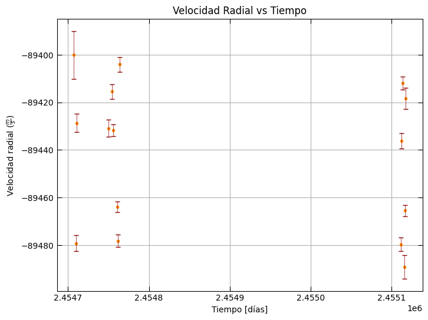
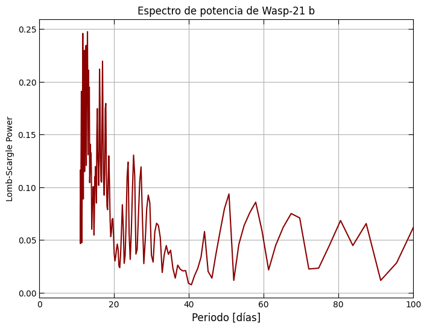
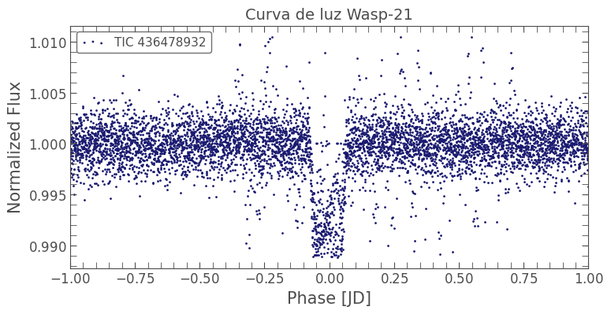
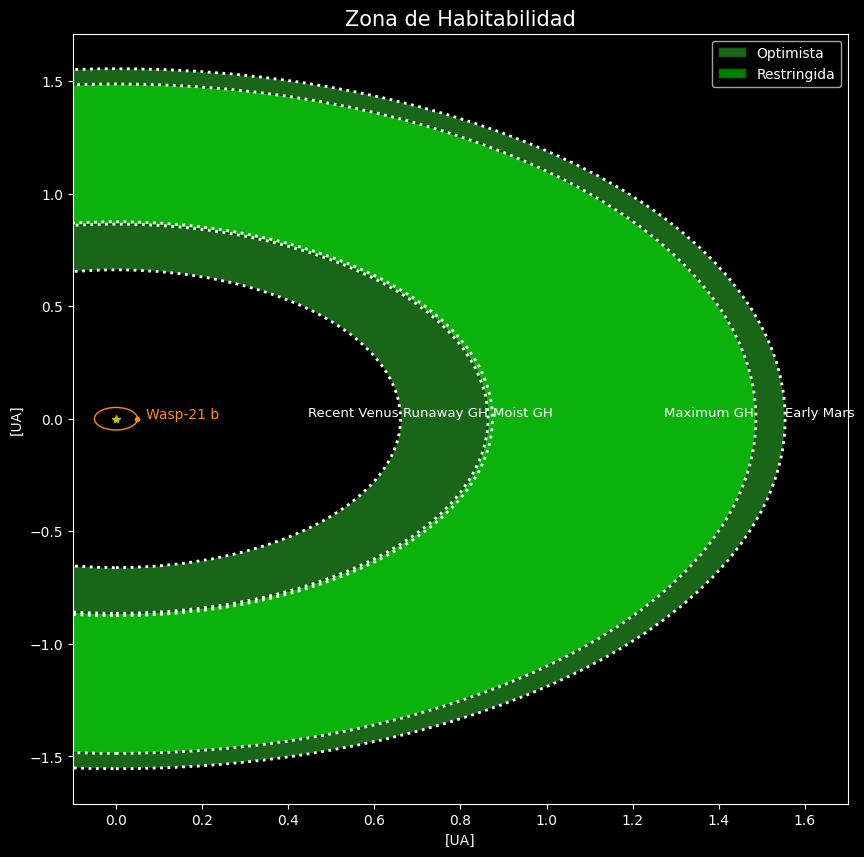

# WASP-21 b: mass, radius and orbit from radial velocity and TESS photometry

*Resumen (ES): análisis de punta a punta del exoplaneta WASP-21 b: periodo y masa a partir de velocidad radial (Lomb-Scargle + ajuste por mínimos cuadrados) y radio a partir de la curva de luz de TESS (BLS).*

[](https://colab.research.google.com/github/AndresL7/wasp21b-exoplanet-analysis/blob/main/notebooks/01_radial_velocity.ipynb)

## Overview
An end-to-end time-series analysis of the hot Saturn **WASP-21 b** using two independent public datasets:

| Notebook | Data | Methods | Output |
|---|---|---|---|
| [`01_radial_velocity`](notebooks/01_radial_velocity.ipynb) | RV curve, NASA Exoplanet Archive (15 points) | Lomb-Scargle periodogram, weighted least-squares (`curve_fit`), Monte Carlo error propagation | Period, semi-amplitude K, planet mass |
| [`02_transit_photometry`](notebooks/02_transit_photometry.ipynb) | TESS light curves via MAST / Lightkurve | Detrending, outlier removal, Box Least Squares, phase folding | Transit period, planet radius |
| [`03_habitable_zone`](notebooks/03_habitable_zone.ipynb) | Stellar scaling relations | Kopparapu et al. (2013) HZ model | HZ boundaries vs. orbit (didactic exercise) |

## Key results

| Quantity | This work | Literature |
|---|---|---|
| Orbital period (Lomb-Scargle) | 4.3241 d | – |
| Semi-amplitude K (simple estimate) | 44.5 m/s | – |
| Planet mass | 0.331 M<sub>J</sub> | 0.30 M<sub>J</sub> (Bouchy et al.) |
| Planet radius | 1.19 R<sub>J</sub> | 1.15 R<sub>J</sub> (Alderson et al.) |

<p align="center">
  
  <br>
  
  
</p>

## Skills demonstrated
Time-series analysis · periodograms (Lomb-Scargle, BLS) · nonlinear curve fitting and uncertainty quantification · Monte Carlo error propagation · data ingestion from public APIs (NASA Exoplanet Archive, MAST) · scientific visualization with Matplotlib.

## Limitations
- Only 15 RV measurements; circular orbit assumed.
- Mass uses stellar mass and inclination from the literature without propagating their uncertainties.
- Planet radius uses the minimum flux as transit depth (noise-sensitive); the median in-transit flux would be more robust.

## Reproduce
```bash
git clone https://github.com/TU_USUARIO/wasp21b-exoplanet-analysis.git
cd wasp21b-exoplanet-analysis
python -m venv .venv && source .venv/bin/activate
pip install -r requirements.txt
jupyter lab notebooks/
```
Notebooks 01 and 02 need internet access (NASA Exoplanet Archive / MAST).

## References
- Bouchy et al. (2010), WASP-21 b discovery.
- Alderson et al. (2020), WASP-21 b transmission spectroscopy.
- Kopparapu et al. (2013), *Habitable Zones Around Main-Sequence Stars: New Estimates*, ApJ 765, 131.
- Lightkurve Collaboration (2018), *Lightkurve: Kepler and TESS time series analysis in Python*.

## Author
Andrés López Echeverri – BSc Astronomy, Universidad de Antioquia.
